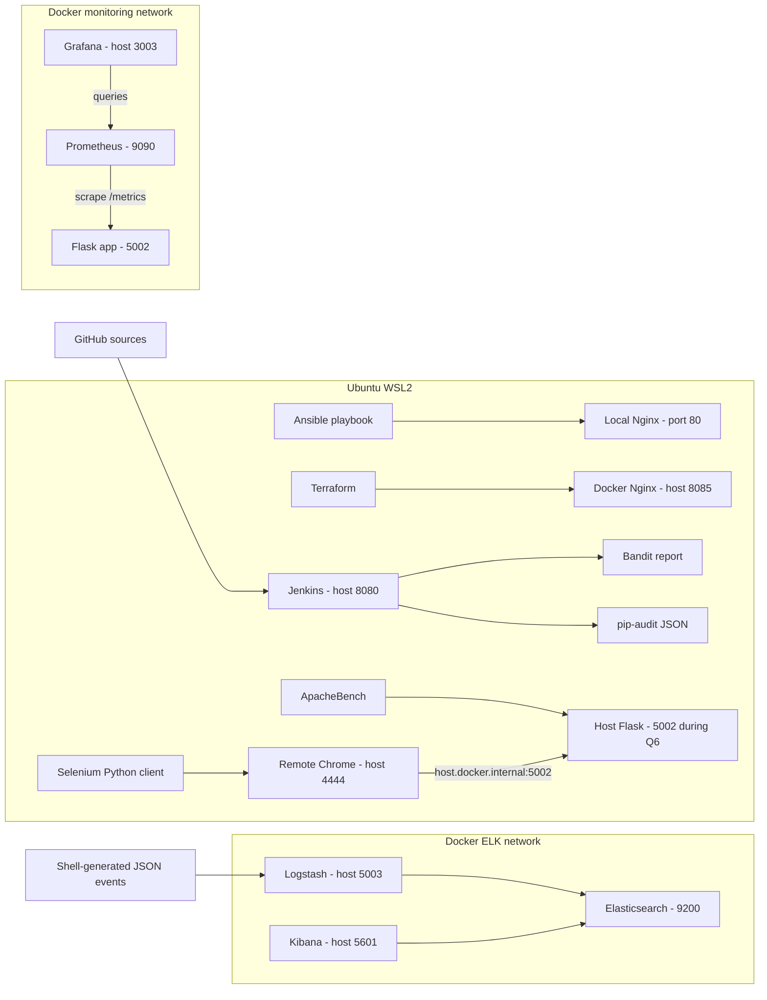

# Architecture and execution modes

[README](../README.md) | [Report](../REPORT.md) | [Reproduce](REPRODUCE.md)

## Components actually used

The lines show the actual lab components, not a single end-to-end deployment orchestrated by Terraform or Jenkins. The static Nginx page, Terraform Nginx welcome page and monitored Flask application are separate targets.

## Application execution modes

### Mode A - Docker monitoring (Q3)

`docker compose -f monitoring/compose.yaml up -d --build` runs the Flask service named `app`. Prometheus resolves `app` on its Compose network and scrapes container port 5002. The host can browse the published app port. Grafana queries Prometheus using the container service name, not host localhost.

### Mode B - WSL feature/load/browser tests (Q6)

The `monitoring-app-1` container was stopped to release host port 5002. The updated Flask process ran in the WSL `.venv`. ApacheBench targeted `127.0.0.1:5002`. Remote Chrome reached it through `host.docker.internal:5002`, which was verified by the successful Selenium execution in this environment.

Both modes cannot publish/listen on the same host port simultaneously. Keeping Prometheus and Grafana containers running does not move the `app:5002` scrape target to the host process. The screenshot of Grafana's increase to approximately 72 belongs to Mode A, not the later 1,000-request run.

To return to Mode A, stop the foreground host Flask process with Ctrl+C and rebuild/start only the Compose app. That is a recommended recovery step, not an action documented as completed in the supplied evidence. Docker service-name behavior is described in [R2](REFERENCES.md#r2-docker-compose-networking).

## Ports and boundaries

| Component | Host endpoint | Internal target / role |
|---|---|---|
| Ansible Nginx | `http://localhost:80` | WSL system service |
| Terraform Nginx | `http://localhost:8085` | Docker port 80 |
| Monitoring app / host Flask | `http://localhost:5002` | One execution mode at a time |
| Prometheus | `http://localhost:9090` | Scrapes `app:5002` |
| Grafana | `http://localhost:3003` | Container port 3000; named volume for Grafana data |
| Elasticsearch | `http://localhost:9200` | Current mapping binds all host interfaces |
| Logstash TCP | `127.0.0.1:5003` | Container 5000; newline-delimited JSON |
| Kibana | `http://localhost:5601` | Container 5601; localhost-bound |
| Jenkins | `http://localhost:8080` | Scans source and requirements |
| Selenium Grid | `http://localhost:4444` | Remote Chrome API; localhost-bound |

The table gives browser-friendly addresses, not proof that every service is restricted to loopback. Inspect the actual Compose files: several published ports omit the host IP. See [security review](SECURITY-FINDINGS.md).

## Storage and lifecycle

Grafana has the `grafana-data` named volume. The displayed ELK Compose configuration does not define persistent data volumes for Elasticsearch. Preserve screenshots and native exports before destructive container recreation; do not assume data will survive every removal/recreation. No automated retention, alert rules, backups or production availability configuration is evidenced.
