# Execution evidence gallery

[README](../README.md) | [Full report](../REPORT.md) | [Original document](source/Lab3-Evidence.docx) | [Manifest](evidence/manifest.csv)

Contains 36 original embedded images plus 2 additional ELK screenshots. Images retain their original pixels; click an image to open the full-resolution source. E IDs are package labels and are not a renumbering of historic SS screenshot names. No command output has been recreated as an image.

**Interpretation:** E20 is an unfinished panel setup; E35 is a supplied derived summary, not an execution log. Final monitoring proof is E21/E23, and load-test proof is E31/E34.

## Environment setup

### E01 - Docker and Compose verification
Docker 29.8.0, Compose v5.5.1 and a successful hello-world execution.

Source: Original Word document, page 1, `word/media/image1.png`. Classification: `execution-screenshot`.

View E01 screenshot (717 x 532)

[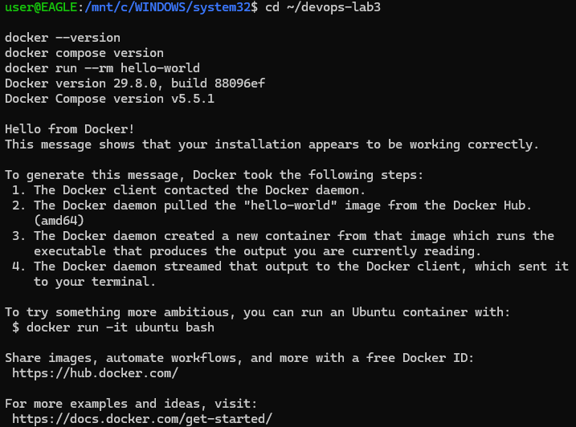](evidence/01-docker-compose-and-hello-world.png)

### E02 - Ansible installation
Ansible core 2.20.1 runs on Python 3.14.4.

Source: Original Word document, page 1, `word/media/image2.png`. Classification: `execution-screenshot`.

View E02 screenshot (1015 x 382)

[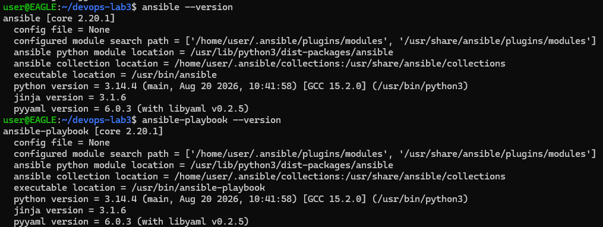](evidence/02-ansible-version.png)

### E03 - Terraform installation
Terraform v1.14.0 on linux_amd64.

Source: Original Word document, page 1, `word/media/image3.png`. Classification: `execution-screenshot`.

View E03 screenshot (410 x 60)

[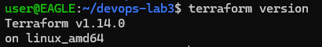](evidence/03-terraform-version.png)

## Q1 - Ansible

### E04 - Ansible local connectivity
Local Ansible target responds with ping: pong.

Source: Original Word document, page 1, `word/media/image4.png`. Classification: `execution-screenshot`.

View E04 screenshot (1094 x 215)

[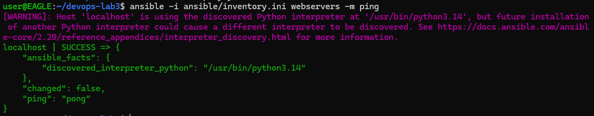](evidence/04-ansible-connectivity.png)

### E05 - First Ansible playbook execution
First successful run: ok=4, changed=2, unreachable=0, failed=0.

Source: Original Word document, page 2, `word/media/image5.png`. Classification: `execution-screenshot`.

View E05 screenshot (1098 x 435)

[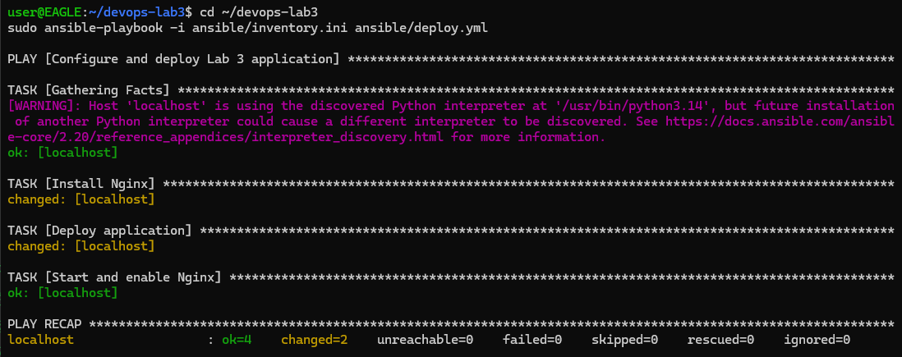](evidence/05-ansible-first-run.png)

### E06 - Deployed HTML from curl
curl returns the HTML deployed to Nginx by Ansible.

Source: Original Word document, page 2, `word/media/image6.png`. Classification: `execution-screenshot`.

View E06 screenshot (593 x 214)

[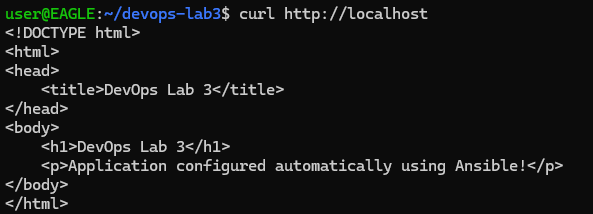](evidence/06-ansible-http-response.png)

### E07 - Ansible-managed web page
The browser shows the Ansible-configured application at localhost.

Source: Original Word document, page 2, `word/media/image7.png`. Classification: `execution-screenshot`.

View E07 screenshot (2560 x 1392)

[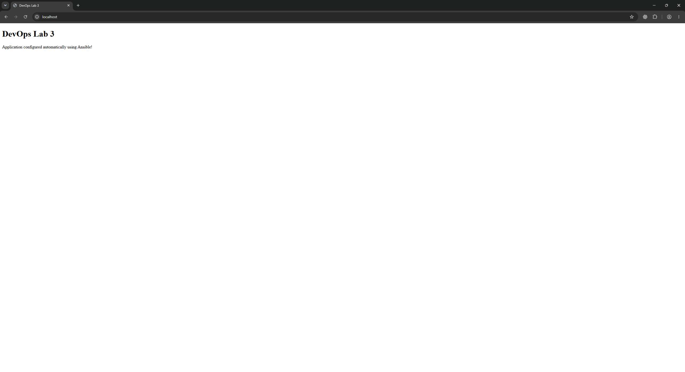](evidence/07-ansible-browser.png)

### E08 - Idempotent Ansible rerun
Repeated playbook: ok=4, changed=0, unreachable=0, failed=0.

Source: Original Word document, page 3, `word/media/image8.png`. Classification: `execution-screenshot`.

View E08 screenshot (1092 x 410)

[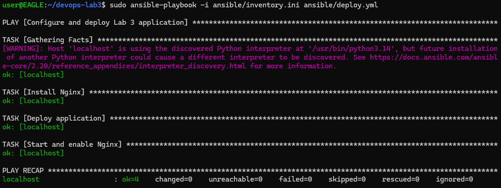](evidence/08-ansible-idempotency.png)

## Q2 - Terraform

### E09 - Terraform initialization
Initialization succeeded; the screenshot records Docker provider v3.9.0.

Source: Original Word document, page 3, `word/media/image9.png`. Classification: `execution-screenshot`.

View E09 screenshot (732 x 461)

[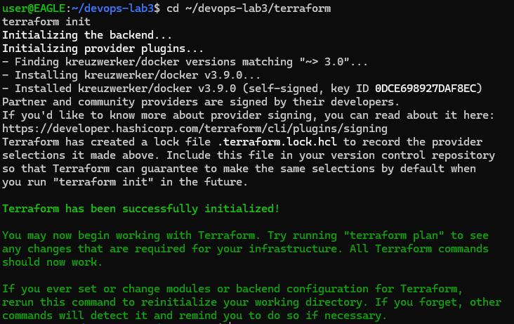](evidence/09-terraform-init.png)

### E10 - Terraform validation and detailed plan
Configuration validation and the proposed Docker resources. The plan continues in E11.

Source: Original Word document, page 4, `word/media/image10.png`. Classification: `execution-screenshot`.

View E10 screenshot (1102 x 1296)

[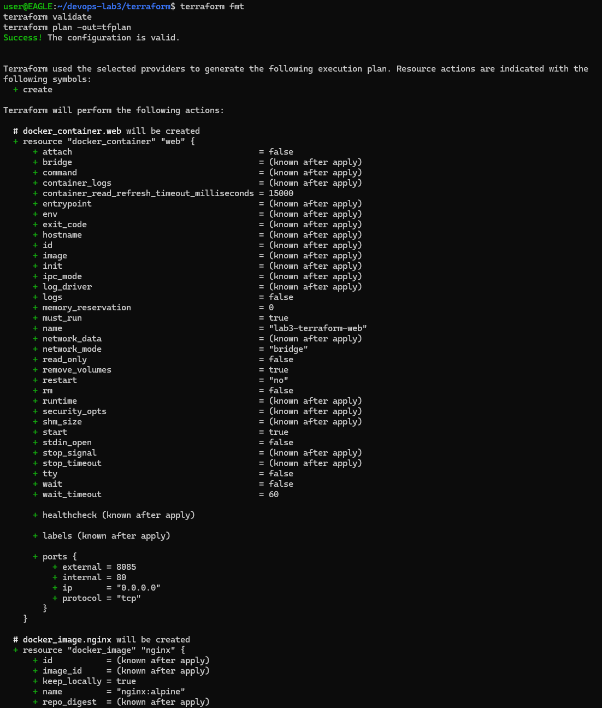](evidence/10-terraform-validate-plan-details.png)

### E11 - Terraform saved-plan summary
Plan: 2 to add, 0 to change, 0 to destroy. Saved as tfplan.

Source: Original Word document, page 5, `word/media/image11.png`. Classification: `execution-screenshot`.

View E11 screenshot (647 x 335)

[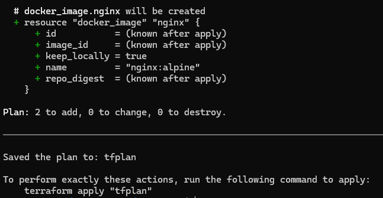](evidence/11-terraform-plan-summary.png)

### E12 - Terraform apply completed
Apply complete: 2 added, 0 changed, 0 destroyed.

Source: Original Word document, page 5, `word/media/image12.png`. Classification: `execution-screenshot`.

View E12 screenshot (975 x 286)

[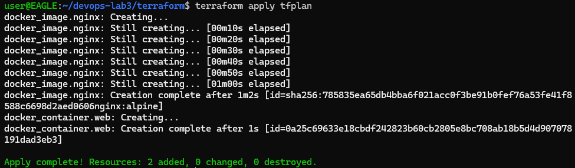](evidence/12-terraform-apply.png)

### E13 - Terraform-provisioned Nginx page
Nginx welcome page served through localhost:8085.

Source: Original Word document, page 5, `word/media/image13.png`. Classification: `execution-screenshot`.

View E13 screenshot (2529 x 1382)

[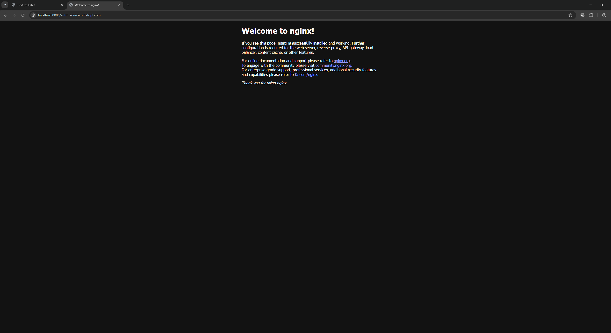](evidence/13-terraform-nginx-browser.png)

### E14 - Container and HTTP verification
The Terraform container is running; curl reports HTTP/1.1 200 OK.

Source: Original Word document, page 6, `word/media/image14.png`. Classification: `execution-screenshot`.

View E14 screenshot (972 x 283)

[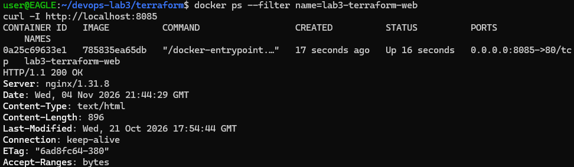](evidence/14-terraform-container-http-200.png)

### E15 - Terraform state resource names
State lists docker_container.web and docker_image.nginx; this is not the state file itself.

Source: Original Word document, page 6, `word/media/image15.png`. Classification: `execution-screenshot`.

View E15 screenshot (517 x 60)

[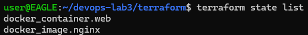](evidence/15-terraform-state-list.png)

## Q3 - Monitoring

### E16 - Monitoring stack startup
The Compose workflow builds the application and starts app, Prometheus and Grafana.

Source: Original Word document, page 6, `word/media/image16.png`. Classification: `execution-screenshot`.

View E16 screenshot (1556 x 932)

[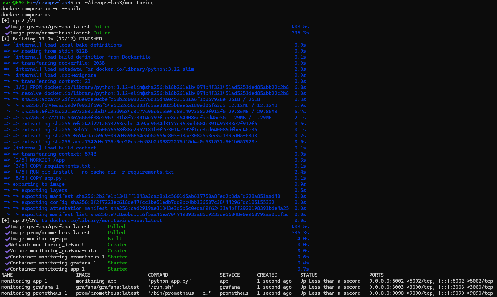](evidence/16-monitoring-compose-start.png)

### E17 - Flask monitoring application
The Flask homepage is accessible on port 5002 in monitoring mode.

Source: Original Word document, page 7, `word/media/image17.png`. Classification: `execution-screenshot`.

View E17 screenshot (2559 x 1390)

[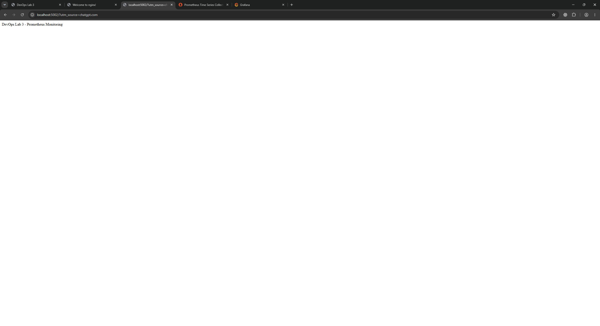](evidence/17-monitoring-homepage.png)

### E18 - Prometheus target UP
The lab3-app target is UP. This captures the earlier Docker monitoring phase.

Source: Original Word document, page 7, `word/media/image18.png`. Classification: `execution-screenshot`.

View E18 screenshot (2559 x 1390)

[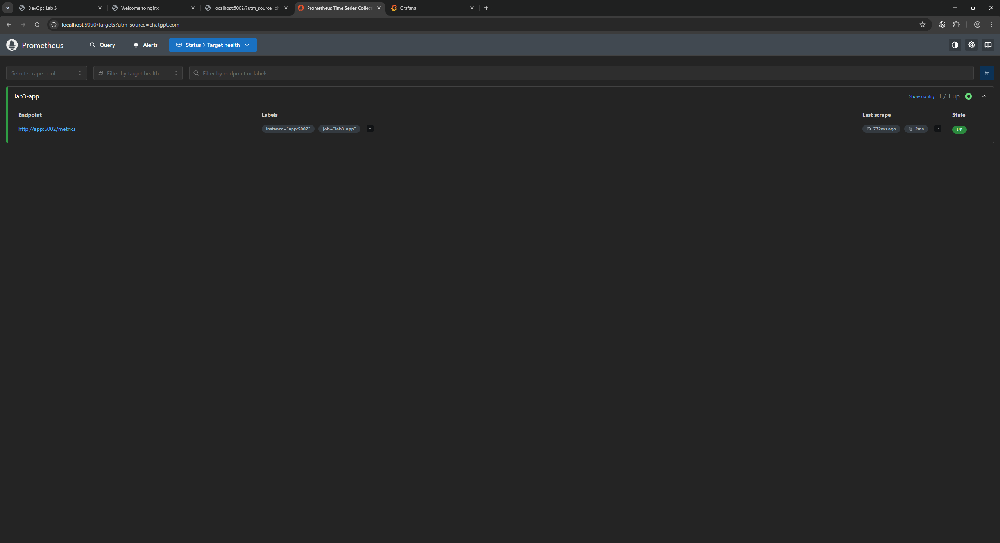](evidence/18-prometheus-target-up.png)

### E19 - Prometheus request counter
lab3_http_requests_total has a sample value of 22.

Source: Original Word document, page 8, `word/media/image19.png`. Classification: `execution-screenshot`.

View E19 screenshot (2559 x 1394)

[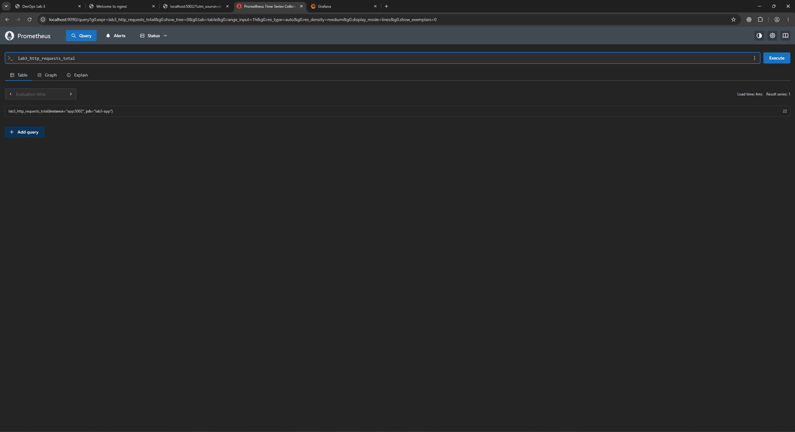](evidence/19-prometheus-request-count.png)

### E20 - Grafana panel configuration in progress
Intermediate panel editor with no completed graph; retained as setup context, not final dashboard proof.

Source: Original Word document, page 8, `word/media/image20.png`. Classification: `setup-in-progress`.

View E20 screenshot (2559 x 1387)

[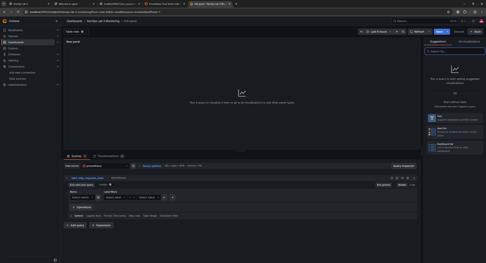](evidence/20-grafana-panel-setup.png)

### E21 - Initial Grafana request graph
HTTP Request Count graph reaches approximately 22.

Source: Original Word document, page 9, `word/media/image21.png`. Classification: `execution-screenshot`.

View E21 screenshot (2559 x 1386)

### E22 - Commands generating monitoring traffic
The terminal shows two traffic loops, for 20 and 50 requests.

Source: Original Word document, page 9, `word/media/image22.png`. Classification: `execution-screenshot`.

View E22 screenshot (1017 x 42)

[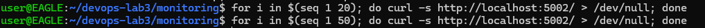](evidence/22-generate-http-traffic.png)

### E23 - Grafana counter after additional traffic
The counter rises to approximately 72. This is before the separate ApacheBench screenshots.

Source: Original Word document, page 9, `word/media/image23.png`. Classification: `execution-screenshot`.

View E23 screenshot (2559 x 1391)

[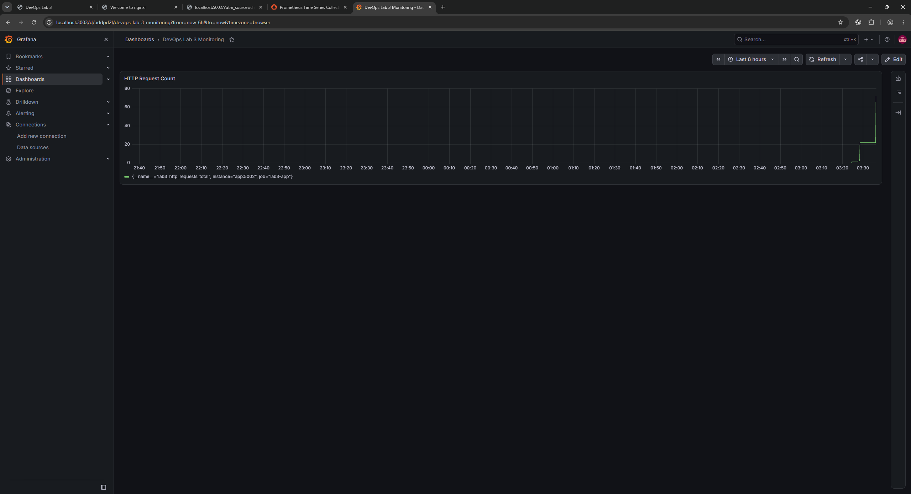](evidence/23-grafana-increased-counter.png)

## Q4 - Logging

### E37 - ELK containers running
Conversation screenshot: Elasticsearch, Logstash and Kibana are Up; published host bindings are visible.

Source: Additional conversation upload: `image(20261104-222213).png`. Classification: `execution-screenshot`.

View E37 screenshot (1054 x 176)

[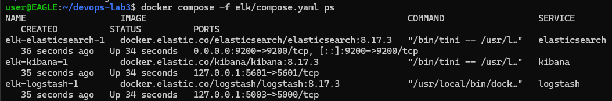](evidence/37-elk-containers-running.png)

### E38 - Kibana welcome page
Conversation screenshot: Kibana is reachable at localhost:5601. The successful ingestion evidence is E24-E25.

Source: Additional conversation upload: `image(20261104-222253).png`. Classification: `execution-screenshot`.

View E38 screenshot (2048 x 1111)

[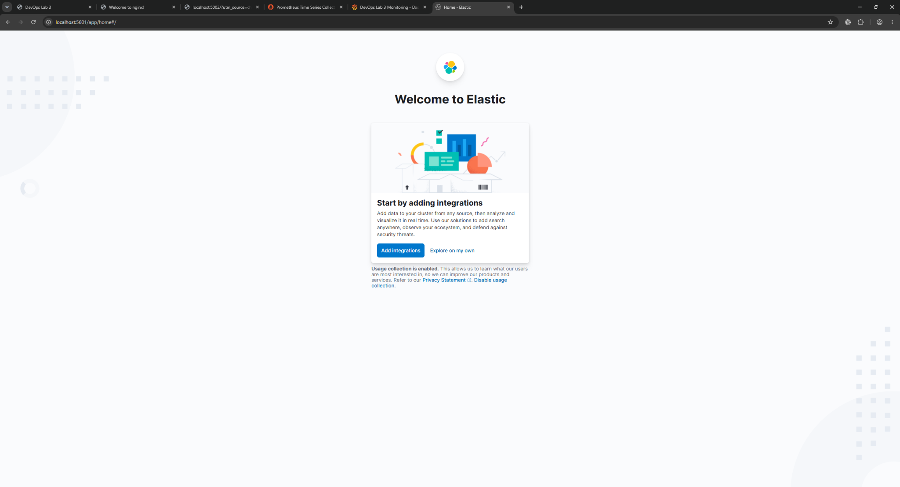](evidence/38-kibana-welcome.png)

### E24 - Elasticsearch document count
Elasticsearch reports 32 indexed documents and zero failed shards.

Source: Original Word document, page 9, `word/media/image24.png`. Classification: `execution-screenshot`.

View E24 screenshot (733 x 193)

[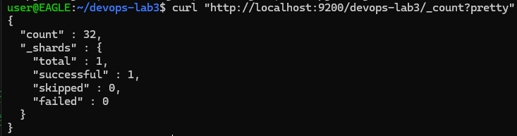](evidence/24-elasticsearch-document-count.png)

### E25 - Kibana Discover parsed events
Discover shows 32 events with fields including message, level, application and @timestamp.

Source: Original Word document, page 10, `word/media/image25.png`. Classification: `execution-screenshot`.

View E25 screenshot (2559 x 1390)

[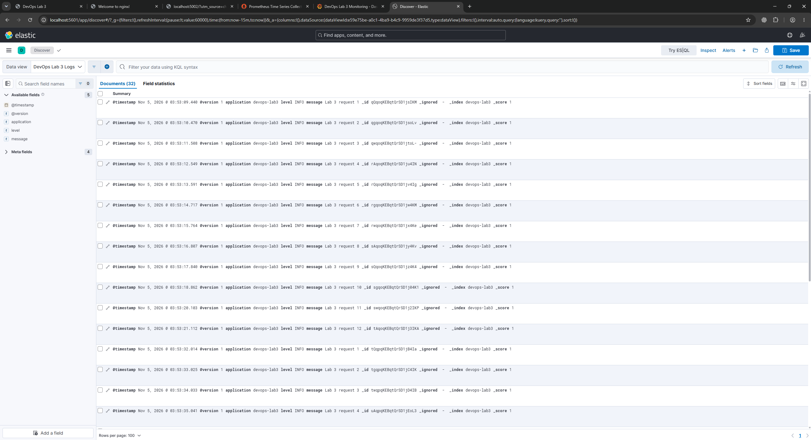](evidence/25-kibana-discover-32-documents.png)

## Q5 - DevSecOps

### E26 - Bandit B104 finding
Bandit reports one Medium-severity / Medium-confidence B104 finding and no High findings.

Source: Original Word document, page 10, `word/media/image26.png`. Classification: `execution-screenshot`.

View E26 screenshot (920 x 591)

[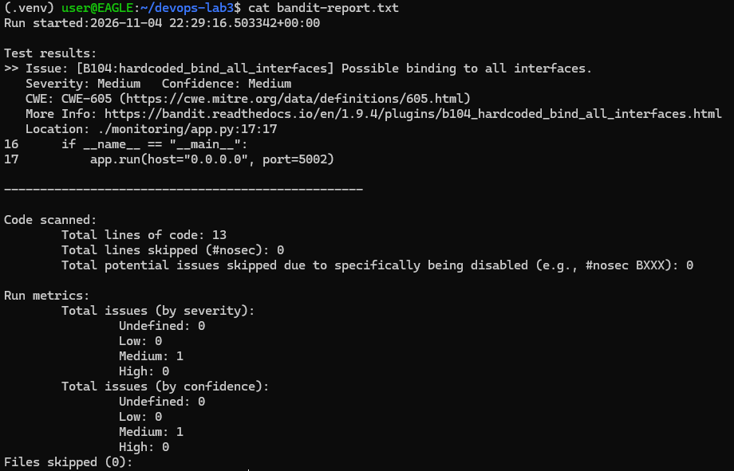](evidence/26-bandit-medium-finding.png)

### E27 - pip-audit dependency results
All eight resolved dependencies have empty vulns arrays in this recorded audit.

Source: Original Word document, page 11, `word/media/image27.png`. Classification: `execution-screenshot`.

View E27 screenshot (708 x 881)

[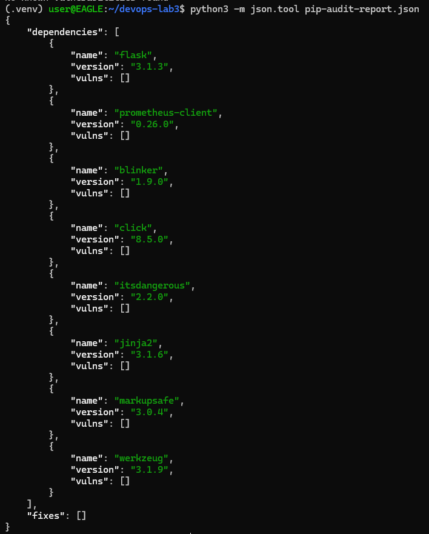](evidence/27-dependency-audit-report.png)

### E29 - Jenkins checkout and scanner installation
Beginning of Jenkins build evidence: checkout and tool installation.

Source: Original Word document, page 12, `word/media/image29.png`. Classification: `execution-screenshot`.

View E29 screenshot (2559 x 1390)

[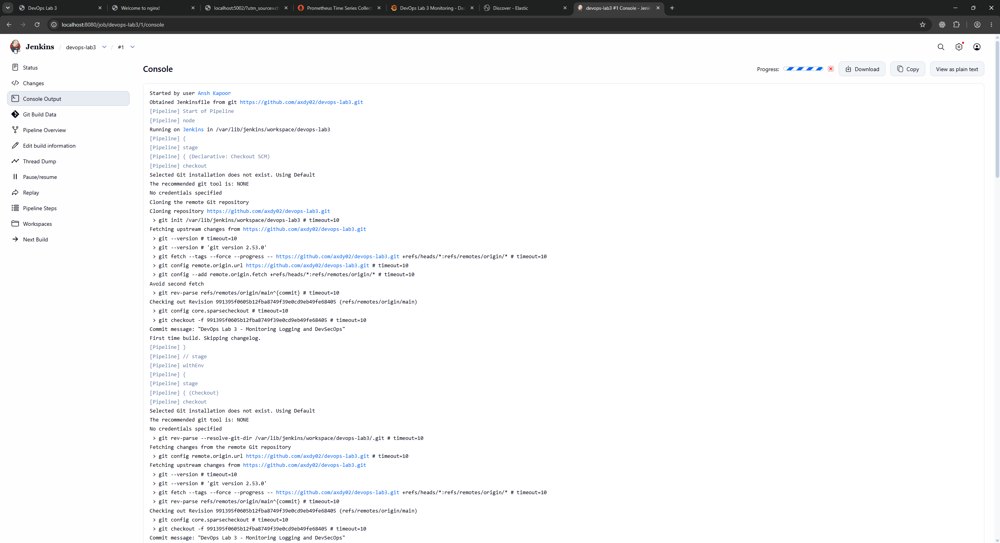](evidence/29-jenkins-checkout-tools.png)

### E30 - Jenkins scans and successful finish
Bandit and pip-audit run, artifacts are archived, and the build finishes SUCCESS. Bandit findings are allowed by the pipeline.

Source: Original Word document, page 13, `word/media/image30.png`. Classification: `execution-screenshot`.

View E30 screenshot (2559 x 1390)

[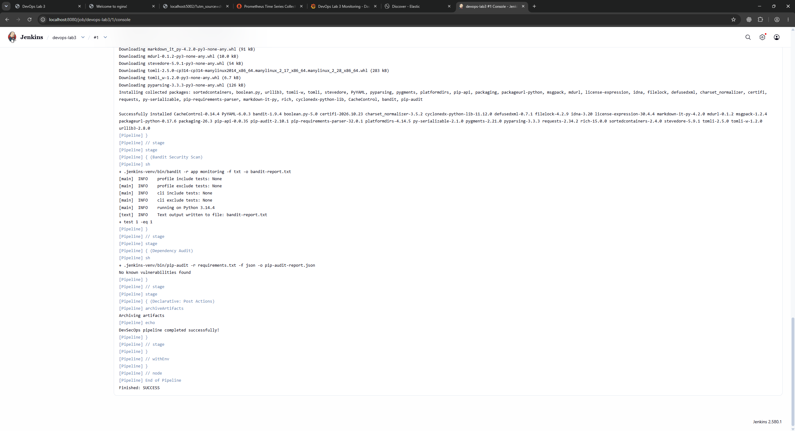](evidence/30-jenkins-scans-success.png)

## Q6 - Testing

### E31 - ApacheBench run A
1,000 requests, concurrency 20, zero failed; 0.609 s; 1,642.37 requests/s; 36-byte body.

Source: Original Word document, page 14, `word/media/image31.png`. Classification: `execution-screenshot`.

View E31 screenshot (752 x 1032)

[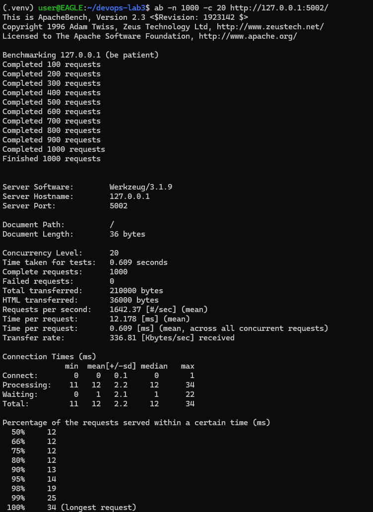](evidence/31-apachebench-run-a.png)

### E32 - Feature flag disabled
Original response: DevOps Lab 3 - Prometheus Monitoring.

Source: Original Word document, page 15, `word/media/image32.png`. Classification: `execution-screenshot`.

View E32 screenshot (2559 x 1387)

[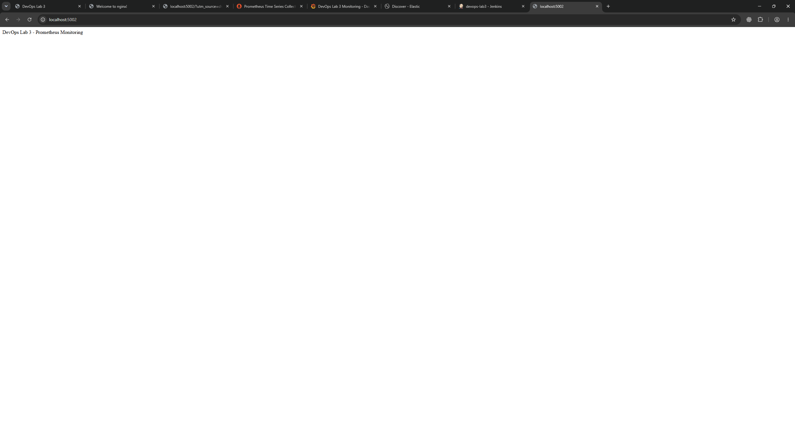](evidence/32-feature-flag-off.png)

### E33 - Feature flag enabled
Enabled response: DevOps Lab 3 - NEW FEATURE ENABLED.

Source: Original Word document, page 15, `word/media/image33.png`. Classification: `execution-screenshot`.

View E33 screenshot (2559 x 1392)

[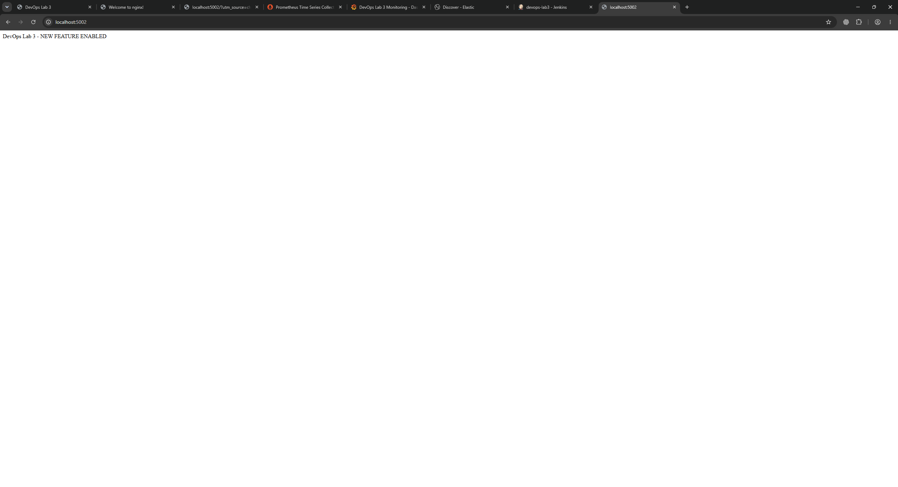](evidence/33-feature-flag-on.png)

### E34 - ApacheBench run B
1,000 requests, concurrency 20, zero failed; 0.595 s; 1,681.71 requests/s; 34-byte body.

Source: Original Word document, page 16, `word/media/image34.png`. Classification: `execution-screenshot`.

View E34 screenshot (873 x 1124)

[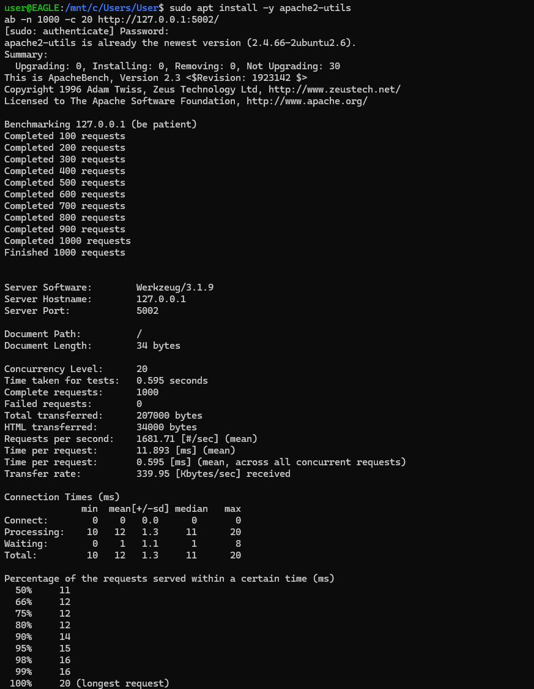](evidence/34-apachebench-run-b.png)

### E35 - Derived load-test summary graphic
Supplied screenshot of an earlier explanatory summary graphic. It restates run B and is not independent execution evidence.

Source: Original Word document, page 17, `word/media/image35.png`. Classification: `derived-summary`.

View E35 screenshot (784 x 718)

[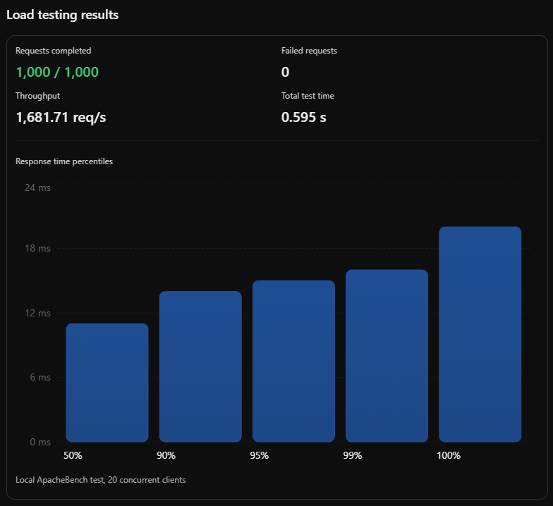](evidence/35-derived-load-test-summary.png)

### E36 - Selenium browser test passed
The test prints PASS for the homepage, enabled feature and Selenium browser automation.

Source: Original Word document, page 17, `word/media/image36.png`. Classification: `execution-screenshot`.

View E36 screenshot (591 x 78)

[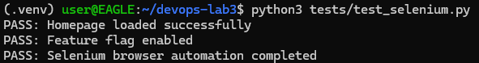](evidence/36-selenium-passed.png)

## Q7 - Repository submission

### E28 - GitHub source repository
GitHub shows the project files before this documentation pack was added.

Source: Original Word document, page 12, `word/media/image28.png`. Classification: `execution-screenshot`.

View E28 screenshot (2496 x 1304)

[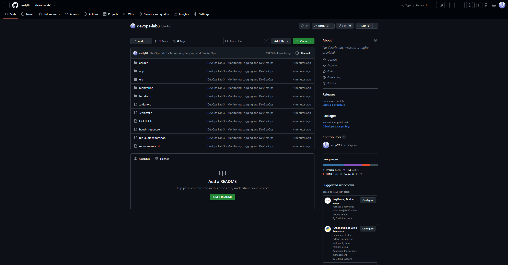](evidence/28-github-repository.png)

